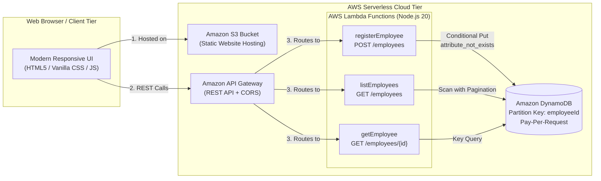

# EmployeeHub — Serverless Employee Registration System

A production-ready, full-stack, serverless web application built on **AWS Serverless Architecture** (Amazon S3, Amazon API Gateway, AWS Lambda, Amazon DynamoDB).

EmployeeHub replaces manual paper-based employee onboarding and spreadsheet tracking with an automated, secure digital workflow.

---

## 🏛️ System Architecture



### 🔄 End-to-End Serverless Execution Pipeline

```text
┌────────────────────────────────────────────────────────┐
│  🖥️ Step 1: Employee Registration Website              │
│     HR enters employee details in the browser          │
└──────────────────────────┬─────────────────────────────┘
                           │
                           ▼
┌────────────────────────────────────────────────────────┐
│  🔀 Step 2: API Gateway                                │
│     Receives the request & validates CORS              │
└──────────────────────────┬─────────────────────────────┘
                           │
                           ▼
┌────────────────────────────────────────────────────────┐
│  ⚡ Step 3: AWS Lambda                                  │
│     Processes and validates the request (Node.js 20)   │
└──────────────────────────┬─────────────────────────────┘
                           │
                           ▼
┌────────────────────────────────────────────────────────┐
│  🗄️ Step 4: DynamoDB                                   │
│     Saves the employee record (conditional write)      │
└──────────────────────────┬─────────────────────────────┘
                           │
                           ▼
┌────────────────────────────────────────────────────────┐
│  ✅ Step 5: Success Message                            │
│     The website displays “Employee registered          │
│     successfully”                                      │
└────────────────────────────────────────────────────────┘
```

---

## 📁 Project Structure

```text
ERWA/
├── frontend/
│   └── index.html                  # Frontend single-page app (ready for S3 hosting)
├── backend/
│   ├── local-server.js             # Local API Gateway & Lambda simulator
│   ├── package.json                # Backend dependencies and scripts
│   └── src/
│       ├── handlers/
│       │   ├── registerEmployee.js # Lambda handler: POST /employees
│       │   ├── listEmployees.js    # Lambda handler: GET /employees
│       │   └── getEmployee.js      # Lambda handler: GET /employees/{id}
│       ├── services/
│       │   └── employeeService.js  # DynamoDB DocumentClient service
│       └── utils/
│           ├── response.js         # Standard CORS & JSON response builder
│           └── validation.js       # Field-level input validation & sanitizer
├── infrastructure/
│   └── template.yaml               # AWS SAM / CloudFormation template
├── package.json                    # Root project scripts
└── README.md                       # Documentation & deployment guide
```

---

## 🚀 How to Run Locally

### Option 1: Instant Standalone Mode (Zero Installation)
1. Open the `frontend` folder in File Explorer.
2. Double-click **`frontend/index.html`** to open it directly in Chrome, Edge, Firefox, or Safari.
3. The application automatically boots in **Mock Mode** using browser `localStorage`.
   - Test employee registration, validation, search, filtering, detail views, and the 5-step architecture simulation.
   - All data persists in your browser.

---

### Option 2: Full-Stack Local Server (API Gateway + Frontend Simulation)
Run the built-in local development server simulating the entire AWS backend:

```bash
# From the project root (d:\ERWA):
node backend/local-server.js
```

Or using npm:
```bash
npm start
```

Open your browser to:
- **Frontend Dashboard:** [http://localhost:3001](http://localhost:3001)
- **REST API:** [http://localhost:3001/employees](http://localhost:3001/employees)

---

## ☁️ How to Deploy to AWS

### Prerequisites
1. **AWS CLI** installed and configured (`aws configure` with your Access Key and Secret Key).
2. **AWS SAM CLI** installed (`sam --version`).
3. Node.js 18 or 20 installed.

---

### Step 1: Deploy Backend & Database with AWS SAM

1. Navigate to the `infrastructure` directory:
   ```bash
   cd infrastructure
   ```

2. Build the serverless application:
   ```bash
   sam build
   ```

3. Deploy using guided deployment:
   ```bash
   sam deploy --guided
   ```

   **Prompts to accept:**
   - **Stack Name:** `employeehub-stack`
   - **AWS Region:** `us-east-1` (or your preferred region)
   - **Confirm changes before deploy:** `Y`
   - **Allow SAM CLI IAM role creation:** `Y`
   - **Disable rollback for faster debugging:** `N`
   - **Save arguments to configuration file:** `Y`

4. Once deployment succeeds, note down the **Outputs**:
   - `ApiUrl`: e.g. `https://abc123xyz.execute-api.us-east-1.amazonaws.com/prod/`
   - `FrontendBucket`: e.g. `employeehub-web-123456789012-us-east-1`
   - `FrontendWebsiteURL`: e.g. `http://employeehub-web-123456789012-us-east-1.s3-website-us-east-1.amazonaws.com`

---

### Step 2: Connect Frontend to Live AWS API

1. In `frontend/index.html` (or `index.html`), find:
   ```javascript
   const API_BASE_URL = '';
   ```
2. Set it to your deployed API Gateway URL:
   ```javascript
   const API_BASE_URL = 'https://abc123xyz.execute-api.us-east-1.amazonaws.com/prod';
   ```

---

### Step 3: Deploy Frontend to S3 Static Website Hosting

Upload `frontend/index.html` to the S3 bucket created by the SAM template:

```bash
aws s3 cp frontend/index.html s3://<YOUR_FRONTEND_BUCKET_NAME>/index.html
```

Your serverless application is now **live on the internet** at your `FrontendWebsiteURL`!

---

## 📡 REST API Reference

| Method | Endpoint | Description | Status Codes |
|---|---|---|---|
| `POST` | `/employees` | Registers a new employee | `201 Created`, `400 Bad Request`, `409 Conflict` |
| `GET` | `/employees` | Lists all employees | `200 OK`, `500 Server Error` |
| `GET` | `/employees/{id}` | Gets employee details by ID | `200 OK`, `404 Not Found` |

### Sample POST `/employees` Request:
```json
{
  "employeeId": "EMP-1001",
  "fullName": "Priya Sharma",
  "email": "priya.sharma@example.com",
  "phone": "+91 9876543210",
  "department": "IT",
  "jobRole": "Senior Cloud Engineer",
  "dateOfJoining": "2024-01-15",
  "employmentType": "Full-Time",
  "workLocation": "Bengaluru"
}
```

---

## 🔒 Security & Best Practices

1. **DynamoDB Conditional Writes**: Prevents duplicate employee IDs using `ConditionExpression: attribute_not_exists(employeeId)`.
2. **Double Validation**: Input constraints (email RFC format, joining date not in future, ID alphanumeric check) are validated on both client and Lambda.
3. **IAM Least Privilege**: Each Lambda function is granted only the required DynamoDB permissions (`DynamoDBCrudPolicy` or `DynamoDBReadPolicy`).
4. **CORS Configured**: API Gateway preflight `OPTIONS` and standard headers are handled automatically.
